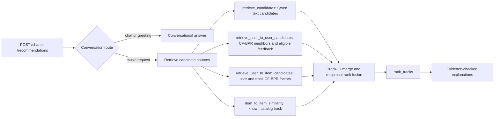

# TalkPlay music recommendation prototype

FastAPI recommendation API backed by Chroma, local Qwen embeddings, LangGraph, LangChain tools,
Pydantic and Groq or OpenRouter. The default Groq model is `openai/gpt-oss-20b`, which Groq
lists on its free plan. Free usage requires a Groq account/key and is subject to
account quotas. The application does not upgrade plans or switch models automatically.

OpenRouter supports `nvidia/nemotron-3-ultra-550b-a55b:free`. Configure
`OPEN_ROUTER_API_KEY` and `OPEN_ROUTER_MODEL` in `.env` (`OPENROUTER_API_KEY` and
`OPENROUTER_MODEL` are also accepted). A blank model selects that Nemotron model.
The app defaults to Groq for recommendations. OpenRouter credentials do not change
that default; they are used separately for the Nemotron judge. Set `LLM_PROVIDER`
explicitly to change the recommendation provider.
OpenRouter explanations use `function_calling` plus Pydantic validation because
this model advertises tool calling, not JSON-schema response formatting.

## Setup (PowerShell)

Run from this `agentic_system` directory. Python 3.11–3.14 is supported by the
project; use a Python version supported by your installed PyTorch build.

```powershell
python -m venv .venv-stable  # Skip if .venv-stable already exists.
.\.venv-stable\Scripts\python.exe -m pip install -c constraints-windows.txt -e '.[dev]'
if (!(Test-Path .env)) { Copy-Item .env.example .env }
```

Set `GROQ_API_KEY` in `.env` to enable provider-generated ranking and explanations.
The key is optional for **local retrieval mode**, which runs the same retrieval/ranking
tools and uses template explanations without provider requests.

On this Windows machine, use `.venv-stable`: official older releases of PyTorch
2.9.1, pandas 2.3.3 and xxhash 3.6.0 have passed import and basic-operation checks.
The constraints file preserves these versions during installation. The original
`.venv` is retained; its newer native libraries were blocked by Smart App Control.

Build the catalog before starting the API:

```powershell
.\.venv-stable\Scripts\python.exe -m music_recommender.ingest
.\.venv-stable\Scripts\python.exe -m music_recommender.cf_data --mode official_test
.\.venv-stable\Scripts\python.exe -m uvicorn main:app --reload
```

The first ingestion downloads the Qwen model. Query and profile embedding inference
runs on CPU by default; set `EMBEDDING_DEVICE=cuda` for an appropriately configured
GPU. Allow several GB of free disk/RAM. Downloads and indexes stay in ignored local
`.cache/` and `data/` directories.

The API uses the full `data/catalog` index by default. For a small setup check,
set `TALKPLAY_CATALOG=sample` in `.env` and build the sample index:

```powershell
.\.venv-stable\Scripts\python.exe -m music_recommender.ingest --sample
```

Ingestion streams the Hugging Face datasets and locally embeds the training profiles
and goals. Full-catalog setup can take substantial time on CPU. Re-running ingestion
upserts supplied vectors and skips already embedded profile/goal IDs. An index is
marked ready only after ingestion finishes. Sample and full indexes live separately
in `data/sample` and `data/catalog`. Stop ingestion before using its catalog in the
API. For different embedding settings, use a new `--data-dir`; never mix models
or dimensions in an existing index.

The second command loads eligible positive training pseudo-interactions from
`../prepared-dataset-eda/data` and the public `test_warm` and `test_cold` CF-BPR
query-vector splits. For internal temporal validation, load with
`--mode internal_validation --skip-test-vectors` and set
`CF_HISTORY_MODE=internal_validation` in the app environment. Held-out targets
are excluded from retrieval.

## Data mapping

All repositories are under `talkpl-ai/` on Hugging Face:

| Dataset | Split | Use |
| --- | --- | --- |
| `TalkPlayData-Challenge-Dataset` | `train` | User profiles, goals and specificity labels, keyed by session/user IDs |
| `TalkPlayData-Challenge-Track-Metadata` | `all_tracks` | Titles, artists, tags; joined by `track_id` |
| `TalkPlayData-Challenge-User-Metadata` | `all_users` | Stored user metadata keyed by `user_id` |
| `TalkPlayData-Challenge-Track-Embeddings` | `all_tracks` | Published Qwen metadata vectors and separate BPR track factors |
| `TalkPlayData-Challenge-User-Embeddings` | `train` | Published BPR user factors in their own collection |
| `TalkPlayData-Challenge-User-Embeddings` | `test_warm`, `test_cold` | Query factors imported separately by `cf_data.py` |

The published **user vectors are 128-dimensional `cf-bpr` factors**, not Qwen
text embeddings. The track dataset has several modalities; this prototype uses
**`metadata-qwen3_embedding_0.6b` (1,024 dimensions)** for semantic retrieval.
Missing/empty vectors are skipped and counted, while malformed vectors fail ingestion.
No supplied catalog vector is re-embedded. Additional session profile and goal
vectors are generated locally using `Qwen/Qwen3-Embedding-0.6B`. Query embeddings
use Qwen's `Instruct: ...\nQuery: ...` format with task-specific instructions.

Collections keep Qwen and BPR spaces separate. After the prepared CF import,
training BPR user vectors and eligible conversational evidence contribute a
separate user-to-user candidate route; test query vectors remain outside the
training neighbor pool.
Track metadata and session context live in SQLite so nested/list-valued fields are
preserved without depending on Chroma metadata serialization.

Only training profile/goal context is indexed as text. Conversation responses,
hidden `thought` fields, and test conversations are not text-indexed. The CF
import separately stores eligible positive training feedback as track IDs.
API requests can select a training session to use as recommendation context.
The separate test evaluation runner omits conversation goals and specificity to
avoid disclosing information unavailable at the current conversation turn.

## Main agent and tools



`main.py` opens the ready catalog and builds the graph. The HTTP router exposes
both `POST /chat` and the compatible `POST /recommendations` endpoint. Pass
`X-Conversation-ID` to associate in-memory graph checkpoints across requests;
the client still supplies its prior `history` and excluded track IDs. A reply
contains `kind` (`chat` or `recommendations`), a conversational `message`,
and any recommendation entries.

The graph first routes each turn. Clear greetings are handled locally without
retrieval. With a configured LLM, ambiguous turns receive a bounded route
decision; the conversational branch can answer without calling music tools.
Recommendation turns use the text `retrieve_candidates` tool, call
`retrieve_user_to_user_candidates` and `retrieve_user_to_item_candidates` when
a listener ID is supplied, optionally call `item_to_item_similarity`, then merge
the sources and call `rank_tracks`
and a separate explanation step. The application injects listener identity
into the user-to-user tool; the model cannot choose another user's history.
`retrieval.py` owns source retrieval and track-ID fusion; `ranking.py` owns
numeric order, exclusions and artist diversity. The tool files expose these
operations to the graph and document the arguments visible to the model.

After `cf_data.py` imports prepared evidence, the graph combines text-to-item
candidates with user-to-user candidates when the query user has a published
CF-BPR vector. The query is compared by cosine similarity with the
**full training-vector pool**, excluding itself. Neighbor tracks come only from
eligible positive training pseudo-interactions. The API returns only a bounded
neighbor summary; candidate support can use every eligible neighbor.
Users with no usable CF-BPR vector receive text candidates.

The user-to-item route compares a published 128-dimensional CF-BPR user factor
against the separate track CF-BPR index using inner product. It excludes
explicitly blocked tracks and any known prior positive training tracks. An
unavailable user factor contributes no candidates; text retrieval still runs.

When the request includes a verified `reference_track_id`, or a single prior
recommendation resolves "more like that," the graph calls `item_to_item_similarity`.
An unresolved "that track" receives a clarification question. Without prepared CF data, recommendation
retrieval uses text and any available item reference; the old profile/goal
neighbor path has been removed.

## Scores and assumptions

The CF path keeps raw cosine and neighbor-support values as evidence but ranks
the merged candidates by reciprocal source ranks: each available source adds
`1 / (60 + rank)`. This avoids adding incomparable Qwen similarity and CF
support and user-to-item inner-product scores. Explicit exclusions are applied before final ranking, and the
ranker enforces the requested limit and artist diversity. The constant and
source contributions still require held-out validation.

Positive neighbor evidence means a track was recommended in a synthetic
conversation followed by feedback indicating goal progress. It does not prove
a listen, like, rating, or endorsement. Missing sources contribute no rank
term; text retrieval remains available when a CF-BPR vector is absent.

## Test-set evaluation

The evaluation runner uses the `test` split of
`talkpl-ai/TalkPlayData-Challenge-Dataset` (the public development set, not the
hidden blind sets). It saves predictions in the
[official evaluator's format](https://github.com/nlp4musa/music-crs-evaluator).

Start with 100 uniformly sampled sessions, keeping all eight turns per session:

```powershell
.\.venv-stable\Scripts\python.exe -m music_recommender.evaluate --sessions 100 --seed 42 --mode groq --output data/evaluations/groq-test-100
```

For an explicitly requested OpenRouter recommendation experiment (not the default Groq recommender), use:

```powershell
.\.venv-stable\Scripts\python.exe -m music_recommender.evaluate --sessions 100 --seed 42 --mode openrouter --output data/evaluations/openrouter-nemotron-test-100
```

The CLI's `--mode` selects the provider explicitly. Free OpenRouter models are checked
against the account's `free_model_daily_requests` allowance before each turn. If fewer
than five requests remain, execution stops and preserves its checkpoint. Run the
same command after the allowance resets to resume. `allowance.json` records the most
recent daily counter; `run_status.json` records completion progress. No paid model
substitution or credit purchase is performed. See [OpenRouter limits](https://openrouter.ai/docs/api/reference/limits).

Use `--sessions 300` for a larger sample, or `--sessions 0` for all 1,000 sessions,
with a different output directory. Sample selection is deterministic and independent
of dataset row order. Ten sessions is a smoke test, not a dependable quality estimate.
One hundred sessions means 800 predictions and up to 4,000 provider requests
(including route selection and an explanation correction); the full split means
up to 40,000 requests. `--delay SECONDS` spaces turns if needed.
`--mode local` explicitly evaluates retrieval with template explanations instead.
Use distinct output directories for different modes, samples and model versions.

Each turn receives the current user message, available profile and earlier recorded
dialogue (teacher-forced history). Earlier played IDs are included with prior
assistant messages. The existing agent retains its usual bounded history window.
The current target, current/future assistant response, hidden `thought` fields,
progress assessments, conversation goal and specificity never reach the agent or
judge. Previous suggestions are not automatically excluded because repeated targets
are valid. Test sessions are not ingested into the training neighbor index.

The evaluation requests up to 20 tracks and raises the response token budget to
4,096 for their explanations. Existing numerical ranking and artist diversity still
apply, so fewer than 20 tracks may be returned. The generated response concatenates
the returned titles, artists and explanations, as in the app's conversation summary.

Metrics follow the public evaluator:

- nDCG@1, @10 and @20: one relevant track, `1 / log2(rank + 1)` if within the cutoff,
  otherwise zero. Average across sessions within each turn, then across eight turns.
- Catalog diversity: distinct recommended IDs divided by the **full official
  metadata catalog**, including tracks missing from our searchable index.
- Lexical diversity: corpus-level Distinct-2, using lowercase whitespace tokens
  with punctuation preserved and no bigrams across response boundaries.
- Nemotron judge via OpenRouter: personalization and explanation-quality integer scores
  from 1 to 5, equally averaged and normalized with `(score - 1) / 4`.

The official judge prompt is private. `llm_judge_proxy` and `composite_proxy` are
explicitly unofficial. With `--no-judge`, both remain `null`; the runner reports
the weighted non-judge subtotal out of **0.70** without reweighting it to 1.0.
The proxy composite uses `0.50*nDCG@20 + 0.10*catalog + 0.10*Distinct-2 + 0.30*judge`.
The score normalization and equal dimension weights are disclosed local assumptions.

To judge already generated Groq responses, configure `OPEN_ROUTER_API_KEY` and
`OPEN_ROUTER_MODEL` in `.env` and run:

```powershell
.\.venv-stable\Scripts\python.exe -m music_recommender.evaluate --sessions 100 --seed 42 --output data/evaluations/groq-test-100 --score-only
```

The judge uses the public prompt in `evaluation/judge.py` and text-only context;
it receives neither the ground-truth item nor the reference answer. One OpenRouter request is needed per prediction. Nemotron judging is enabled by
default; use `--no-judge` to skip it. `--judge-model` overrides the configured
OpenRouter judge model. No Gemini API calls are made.

Outputs remain under the ignored `data/` directory:

- `inputs.json` pins dataset revisions, chosen sessions and official catalog IDs.
- `manifest.json` records settings, code hash and catalog configuration.
- `checkpoint.jsonl` saves each completed prediction durably; rerun the same command
  to resume. Configuration/code mismatches are rejected to prevent mixed results.
- `predictions.json` contains the official prediction fields; `scores.json` contains
  aggregate/per-turn scores, generation-mode counts and a session bootstrap interval.
- `coverage.json` counts targets missing from the index; those targets remain scored.
- Optional judge checkpoint and manifest record the proxy's model, prompt and scores.

Missing predictions, invalid IDs and duplicate predictions fail validation instead
of being silently omitted. Recommendation-provider fallback stops the run with `last_failure.json`,
preserving completed predictions; use `--allow-fallbacks` only for an intentionally
mixed-mode experiment. A failed/incomplete run does not produce aggregate scores.
The percentile bootstrap resamples complete sessions 2,000 times; its descriptive
95% interval does not capture model randomness or repeated users across sessions.
Degenerate samples return no interval. Compare systems on the same selected sessions:
catalog coverage and Distinct-2 depend on the number and length of responses.

## Verification

```powershell
.\.venv-stable\Scripts\python.exe -m pytest -q
.\.venv-stable\Scripts\python.exe -m ruff check src tests main.py
```

Tests use small synthetic vectors with real Chroma/SQLite and LangGraph. They cover
ingestion joins/idempotency, vector separation, weighted scoring and missing values,
self-user exclusion, user deduplication, specificity, ID/tag validation, tool calls,
and provider failure behavior. They do not measure real recommendation quality.

### Agent refactor verification (2026-11-17)

The final `.venv-stable` run passed 28 tests, including all nine new tool-contract
and agent regression cases. One existing retrieval test failed with Chroma's
intermittent `Nothing found on disk` error, also documented below. The new tests
cover model-facing schemas, injected context, typed outputs, unknown IDs, request
isolation, long local queries, invalid tool calls and visible catalog failures.
Ruff and `git diff --check` passed. Groq behavior uses a scripted model in tests;
no live provider request was made for this refactor.

### Original environment verification (2026-11-09)

Dependencies are installed in this project's existing `.venv`. Activating that
environment confirms it resolves to `agentic_system/.venv/Scripts/python.exe`.
Seven independent data-contract and real Chroma/SQLite storage tests pass; lint,
syntax compilation and `pip check` also pass.

Full runtime verification in the original `.venv` was blocked by **Windows Application Control**:
it rejects native modules in `xxhash`, pandas, and PyTorch (`WinError 4551` for
`torch.dll`). Activation does not resolve this OS-level block. Dataset ingestion
stops before downloading the dataset/model, and the sample index is not ready.
The full graph tests and API flow were not verified in that environment. After credentials
were configured, Hugging Face authentication and a live strict JSON Schema response
from Groq's `openai/gpt-oss-20b` both passed via direct HTTPS requests. These checks
confirm the keys/provider work, but do not validate the blocked LangChain runtime.
Use a trusted environment in which these dependencies are allowed, or have the
machine's administrator resolve the application-control policy, then rerun the
sample ingestion and full tests. No security settings have been changed.

The independent checks can be run without optional pytest plugins:

```powershell
$env:PYTEST_DISABLE_PLUGIN_AUTOLOAD = '1'
.\.venv\Scripts\python.exe -m pytest -q tests/test_data_contracts.py
Remove-Item Env:PYTEST_DISABLE_PLUGIN_AUTOLOAD
```

This limited test command does not verify the blocked provider/model libraries.

To repeat the credential/provider checks without printing secrets:

```powershell
.\.venv\Scripts\python.exe tools/check_connections.py
```

This makes one small Groq inference request and checks Hugging Face authentication.

### Older native dependencies (2026-11-10)

The isolated `.venv-stable` successfully imports xxhash 3.6.0, pandas 2.3.3 and
PyTorch 2.9.1. Hashing, DataFrame aggregation and tensor multiplication all pass.
Chroma is also pinned to 1.3.5: the newer 1.5.9 failed two index-reopening tests.
SciPy 1.16.3 and scikit-learn 1.7.2 are pinned for the local embedding stack;
`SentenceTransformer` now imports successfully. Obsolete files from the interrupted
SciPy replacement were removed from this isolated environment.
One run passed all 20 application tests. A final rerun passed 19 and reproduced
an intermittent Chroma `Nothing found on disk` error in the local graph test.
The package-import blocker is resolved, but that storage issue remains unresolved.
Tests use synthetic embeddings; the full dataset/model ingestion still needs to run.
No Windows security settings were changed. Run all dependency checks with:

```powershell
.\.venv-stable\Scripts\python.exe tools/check_runtime.py
```

## References

- [Groq free-plan limits](https://console.groq.com/docs/rate-limits)
- [Groq structured outputs](https://console.groq.com/docs/structured-outputs)
- [Qwen embedding model and query instructions](https://huggingface.co/Qwen/Qwen3-Embedding-0.6B)
- [TalkPlay training conversations](https://huggingface.co/datasets/talkpl-ai/TalkPlayData-Challenge-Dataset)
- [TalkPlay track embeddings](https://huggingface.co/datasets/talkpl-ai/TalkPlayData-Challenge-Track-Embeddings)
- [TalkPlay user embeddings](https://huggingface.co/datasets/talkpl-ai/TalkPlayData-Challenge-User-Embeddings)

### Explanation validation repair

A live Nemotron response omitted one of 17 selected track IDs. The agent now permits
one correction request containing the validation error and evidence for only missing
or invalid entries. Valid entries are retained, and the merged result is validated. The
corrected draft must pass the same exact-ID, uniqueness and tag checks; a second
failure remains a labeled fallback and stops strict evaluation. Truncation and
missing/duplicate/unexpected IDs are now reported explicitly. The four-request
upper bound includes this correction. Current retry artifacts use
`data/evaluations/openrouter-nemotron-test-100-v3`.

### Current evaluation: Groq without a judge

The current baseline uses Groq (`GROQ_MODEL`) for recommendations and skips LLM
judging. Report nDCG@1/10/20, catalog diversity, Distinct-2 and the weighted subtotal
out of 0.70. This is not the full challenge composite.

On the current limited plan, start with one complete eight-turn session. The
GPT-OSS `low` reasoning setting and concise explanations reduce token usage.
The agent retries transient Groq failures at most twice; pacing between turns
does not bypass per-minute or daily limits. Checkpoints allow an identical run to
resume. Earlier Nemotron recommendation runs are not Groq evaluation results.

```powershell
$env:GROQ_REASONING_EFFORT='low'
.\.venv-stable\Scripts\python.exe -m music_recommender.cf_data --prepared-dir ../prepared-dataset-eda/data --mode official_test
.\.venv-stable\Scripts\python.exe -m music_recommender.evaluate --sessions 1 --seed 42 --mode groq --explanation-provider same --prepared-dir ../prepared-dataset-eda/data --no-judge --delay 60 --output data/evaluations/workI-prepared-pilot
```

This evaluates the merged `workI` ReAct agent using the prepared branch's positive,
labeled training interactions. The official test targets remain evaluation labels;
test interactions never enter neighbor history. The existing full catalog supplies
track metadata and vectors. Each run records the prepared history file hash and
the published query-vector hash. `--explanation-provider same` (the evaluation
default) uses the recommendation provider for explanations even if an OpenRouter
key exists. It is independent of `--no-judge`, which disables judging entirely.
Use a new output directory after code or data changes; old predictions cannot be
resumed as results for this merged system.

Tag correction requests constrain their JSON schema to supplied track IDs and
literal tag strings. Errors identify unsupported citations, and repaired entries
still undergo per-track validation, including rejection of tags borrowed from
another track. No unsupported tags are silently removed or accepted.
