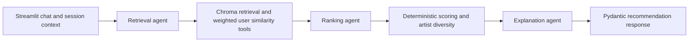

# TalkPlay music recommendation prototype

Streamlit chat backed by Chroma, local Qwen embeddings, LangGraph, LangChain tools,
Pydantic and Groq. The default inference model is `openai/gpt-oss-20b`, which Groq
lists on its free plan. Free usage requires a Groq account/key and is subject to
account quotas. The application does not upgrade plans or switch models automatically.

## Setup (PowerShell)

Run from this `agentic_system` directory. Python 3.11–3.14 is supported by the
project; use a Python version supported by your installed PyTorch build.

```powershell
python -m venv .venv-stable  # Skip if .venv-stable already exists.
.\.venv-stable\Scripts\python.exe -m pip install -c constraints-windows.txt -e '.[dev]'
if (!(Test-Path .env)) { Copy-Item .env.example .env }
```

Set `GROQ_API_KEY` in `.env`, or enter it in the app's password field. The key is
optional for **local retrieval mode**, which runs the same retrieval/ranking tools
and uses template explanations without any Groq requests.

On this Windows machine, use `.venv-stable`: official older releases of PyTorch
2.9.1, pandas 2.3.3 and xxhash 3.6.0 have passed import and basic-operation checks.
The constraints file preserves these versions during installation. The original
`.venv` is retained; its newer native libraries were blocked by Smart App Control.

Build a small index first (300 source tracks and 24 training sessions):

```powershell
.\.venv-stable\Scripts\python.exe -m music_recommender.ingest --sample
.\.venv-stable\Scripts\python.exe -m streamlit run app.py
```

Select **Sample catalog** in the sidebar. The first ingestion downloads the Qwen
model, which is substantially larger than the sample dataset. Query and profile
embedding inference runs on CPU by default; set `EMBEDDING_DEVICE=cuda` for an
appropriately configured GPU. Allow several GB of free disk/RAM. Downloads and
indexes stay in ignored local `.cache/` and `data/` directories.

For meaningful recommendation testing, build the full catalog:

```powershell
.\.venv-stable\Scripts\python.exe -m music_recommender.ingest
```

This streams the Hugging Face datasets and locally embeds the training profiles
and goals. Full setup can take substantial time on CPU. Re-running the same command
upserts supplied vectors and skips already embedded profile/goal IDs. An index is
marked ready only after ingestion finishes. Sample and full indexes live separately
in `data/sample` and `data/catalog`. Stop ingestion before using its catalog in the
app. For different embedding settings, use a new `--data-dir`; never mix models
or dimensions in an existing index.

## Data mapping

All repositories are under `talkpl-ai/` on Hugging Face:

| Dataset | Split | Use |
| --- | --- | --- |
| `TalkPlayData-Challenge-Dataset` | `train` | User profiles, goals and specificity labels, keyed by session/user IDs |
| `TalkPlayData-Challenge-Track-Metadata` | `all_tracks` | Titles, artists, tags; joined by `track_id` |
| `TalkPlayData-Challenge-User-Metadata` | `all_users` | Stored user metadata keyed by `user_id` |
| `TalkPlayData-Challenge-Track-Embeddings` | `all_tracks` | Published Qwen metadata vectors and separate BPR track factors |
| `TalkPlayData-Challenge-User-Embeddings` | `train` | Published BPR user factors in their own collection |

The published **user vectors are 128-dimensional `cf-bpr` factors**, not Qwen
text embeddings. The track dataset has several modalities; this prototype uses
**`metadata-qwen3_embedding_0.6b` (1,024 dimensions)** for semantic retrieval.
Missing/empty vectors are skipped and counted, while malformed vectors fail ingestion.
No supplied catalog vector is re-embedded. Additional session profile and goal
vectors are generated locally using `Qwen/Qwen3-Embedding-0.6B`. Query embeddings
use Qwen's `Instruct: ...\nQuery: ...` format with task-specific instructions.

Collections keep Qwen and BPR spaces separate. BPR vectors are retained for future
collaborative experiments; they do **not** affect the default semantic scores.
Track metadata and session context live in SQLite so nested/list-valued fields are
preserved without depending on Chroma metadata serialization.

Only training profile/goal context is indexed. Conversation responses, hidden
`thought` fields, progress assessments and test conversations are not indexed.
This is an interactive prototype, not a challenge evaluation harness: selecting a
training session preloads its supplied goal, which must not be assumed available
at an arbitrary turn in a future evaluation protocol.

## Three agents



1. **Retrieval agent:** one Groq tool call constructs the current music query using
   recent conversation. The retrieval tool finds tracks and training sessions;
   `calculate_user_similarity` combines the three components. The current user is
   excluded and only the best matching session per other user is kept.
2. **Ranking agent:** one tool call can exclude candidate IDs that clearly conflict
   with explicit preferences. Python computes the score and stable order, limits
   any primary artist to two tracks, and ranks the supporting users by their weighted
   track affinity. The agent cannot invent candidates or numerical scores.
3. **Explanation agent:** a separate structured-output request explains the selected
   tracks. Pydantic validates the output, and application checks enforce exact track
   IDs, no duplicates, and catalog-backed cited tags. Titles/artists always come from
   metadata. Free-text explanations still require evaluation for semantic accuracy.

Tool calling and JSON Schema output are separate requests. Maximum three Groq
requests per turn, zero automatic retries, and bounded candidate/history context
limit inference cost. Provider/schema failures produce visibly labeled local
fallbacks. A rate-limited account can still use local retrieval. Temperature zero
and structured outputs do not promise identical LLM decisions across runs.

## Scores and assumptions

Cosine values are mapped to `[0, 1]` by `(cosine + 1) / 2`. Similarities are relative
scores, not probabilities or evidence of recorded likes.

```text
user_similarity = weighted_mean(profile_similarity, goal_similarity, specificity_match)
default weights = 0.50 profile + 0.35 goal + 0.15 specificity
specificity_match = 1 if the dataset labels match exactly, otherwise 0

neighbor_affinity(track) = weighted_mean(
    cosine01(neighbor_profile_vector, track_vector), weights=user_similarity
)
track_score = 0.75 * query_similarity + 0.25 * neighbor_affinity
```

Missing components are omitted and remaining weights renormalized. Unspecified
specificity is not guessed. Unknown/new listeners can enter a profile or rely on
goal similarity. Without usable neighbor evidence the track score is query
similarity alone. All weights are adjustable in the sidebar and require validation
on held-out data; these defaults are not tuned.

User candidate generation takes the union of top profile and goal matches and then
applies the combined score; it is an approximate candidate search, not a full scan
for the global optimum of all three components. Specificity is compared as an exact
categorical label without inventing meanings for its two letters. Similar user
support is **predicted semantic affinity**, never an assertion that those users
liked, listened to, or endorsed a track.

Conversation history is scoped to the browser session. Changing the selected
profile/catalog or pressing **Start a new conversation** resets it. The app can
exclude previous suggestions. It does not persist chat across server restarts.

## Verification

```powershell
.\.venv-stable\Scripts\python.exe -m pytest -q
.\.venv-stable\Scripts\python.exe -m ruff check src tests app.py
```

Tests use small synthetic vectors with real Chroma/SQLite and LangGraph. They cover
ingestion joins/idempotency, vector separation, weighted scoring and missing values,
self-user exclusion, user deduplication, specificity, ID/tag validation, tool calls,
and provider failure behavior. They do not measure real recommendation quality.

### Original environment verification (2026-11-09)

Dependencies are installed in this project's existing `.venv`. Activating that
environment confirms it resolves to `agentic_system/.venv/Scripts/python.exe`.
Seven independent data-contract and real Chroma/SQLite storage tests pass; lint,
syntax compilation and `pip check` also pass.

Full runtime verification in the original `.venv` was blocked by **Windows Application Control**:
it rejects native modules in `xxhash`, pandas, and PyTorch (`WinError 4551` for
`torch.dll`). Activation does not resolve this OS-level block. Dataset ingestion
stops before downloading the dataset/model, and the sample index is not ready.
The full graph tests and Streamlit flow have not been verified. After credentials
were configured, Hugging Face authentication and a live strict JSON Schema response
from Groq's `openai/gpt-oss-20b` both passed via direct HTTPS requests. These checks
confirm the keys/provider work, but do not validate the blocked LangChain runtime.
Use a trusted environment in which these dependencies are allowed, or have the
machine's administrator resolve the application-control policy, then rerun the
sample ingestion and full tests. No security settings have been changed.

The independent checks can be run without optional pytest plugins:

```powershell
$env:PYTEST_DISABLE_PLUGIN_AUTOLOAD = '1'
.\.venv\Scripts\python.exe -m pytest -q tests/test_data_contracts.py
Remove-Item Env:PYTEST_DISABLE_PLUGIN_AUTOLOAD
```

This limited test command does not verify the blocked provider/model libraries.

To repeat the credential/provider checks without printing secrets:

```powershell
.\.venv\Scripts\python.exe tools/check_connections.py
```

This makes one small Groq inference request and checks Hugging Face authentication.

### Older native dependencies (2026-11-10)

The isolated `.venv-stable` successfully imports xxhash 3.6.0, pandas 2.3.3 and
PyTorch 2.9.1. Hashing, DataFrame aggregation and tensor multiplication all pass.
Chroma is also pinned to 1.3.5: the newer 1.5.9 failed two index-reopening tests.
SciPy 1.16.3 and scikit-learn 1.7.2 are pinned for the local embedding stack;
`SentenceTransformer` now imports successfully. Obsolete files from the interrupted
SciPy replacement were removed from this isolated environment.
One run passed all 20 application tests. A final rerun passed 19 and reproduced
an intermittent Chroma `Nothing found on disk` error in the local graph test.
The package-import blocker is resolved, but that storage issue remains unresolved.
Tests use synthetic embeddings; the full dataset/model ingestion still needs to run.
No Windows security settings were changed. Run all dependency checks with:

```powershell
.\.venv-stable\Scripts\python.exe tools/check_runtime.py
```

## References

- [Groq free-plan limits](https://console.groq.com/docs/rate-limits)
- [Groq structured outputs](https://console.groq.com/docs/structured-outputs)
- [Qwen embedding model and query instructions](https://huggingface.co/Qwen/Qwen3-Embedding-0.6B)
- [TalkPlay training conversations](https://huggingface.co/datasets/talkpl-ai/TalkPlayData-Challenge-Dataset)
- [TalkPlay track embeddings](https://huggingface.co/datasets/talkpl-ai/TalkPlayData-Challenge-Track-Embeddings)
- [TalkPlay user embeddings](https://huggingface.co/datasets/talkpl-ai/TalkPlayData-Challenge-User-Embeddings)
